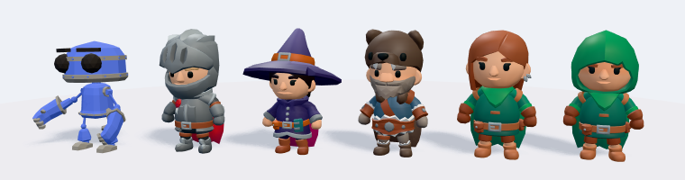
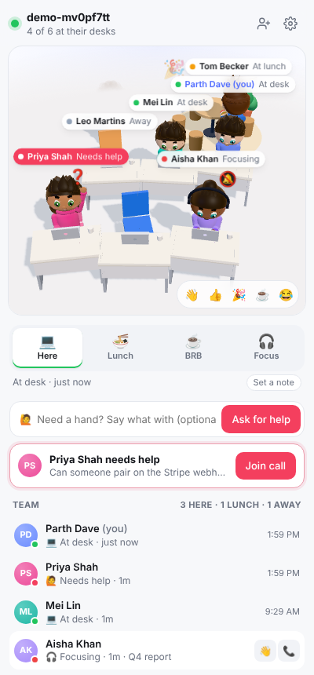
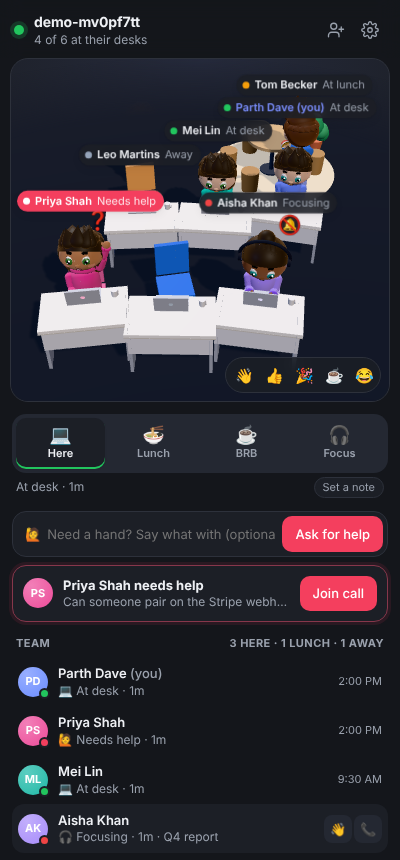
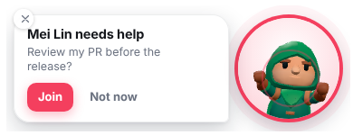
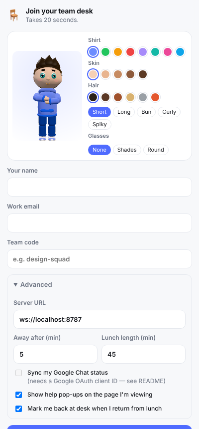

# Deskmate: your team's virtual desk

Deskmate is a live 3D desk where everyone on your team sits together. You can see at a glance who's at their desk, who's at lunch, who's focusing and who's away. When you're stuck, one click asks the team for help. A teammate taps the pop-up and you're both in the same Google Meet within a few seconds.

It has three parts:

| Part | What it does |
|---|---|
| **Chrome extension** (`extension/`) | Desk in Chrome's side panel, help pop-ups on whatever page you're on, Google Meet hand-off, auto-away. Runs on macOS, Windows, Linux and ChromeOS. |
| **Mac menu-bar app** (`companion/`) | Icon and live count in the top menu bar, a one-click desk dropdown, help/call bubbles that float over **every** app (even full-screen), global shortcuts, and macOS Focus → Deskmate Focus. |
| **Server** (`cloudflare/` or `server/`) | A small WebSocket service, hosted free on Cloudflare or as a Node process, for presence, help requests and sharing the Meet link (plus signalling for the optional built-in audio). It never sees or stores audio. |



<p>
  
  
</p>

On the desk above: Priya is asking for help (hand up), Aisha is in Focus (her *Do Not Disturb* board is up), Tom is at the café table for lunch and Leo is BRB, hidden inside his box in the corner.

<p>
  
  
</p>

---

## Try it in 5 minutes (local)

```bash
# 1. server
cd server && npm install && npm start          # → ws://localhost:8787

# 2. Chrome extension
#    chrome://extensions → turn on Developer mode → "Load unpacked" → pick the extension/ folder
#    Pin Deskmate, click the icon → the side panel opens → enter name + team code → Join desk

# 3. Mac menu-bar app (optional)
cd companion && npm install && npm start
```

Open a second Chrome profile, or use a teammate's machine on the same network with `ws://<your-ip>:8787`, and join the same team code to see two people on the desk.

To fill the desk with simulated teammates for a demo:

```bash
node test/demo.cjs --live   # keeps 5 bots online in a team; set TEAM=<your code> to join theirs
```

---

## Features

**Presence that runs itself**

- **One-click status bar:** 💻 Here · 🍜 Lunch · ☕ BRB · 🎧 Focus · 🌴 Leave. Click the active one again to go back to "Here".
- **Auto-away:** after *N* minutes idle, or the moment your screen locks, you show as 💤 Away. You come back automatically when you're active again.
- **Lunch timer:** "back in 32m" shows for everyone. Use **+15m** if lunch runs long. When you come back to your computer you're marked back at your desk without clicking anything (you can turn this off).
- **Google Chat sync:** with Google Chat or Gmail open in a tab, your Chat status (*In a meeting*, *Do not disturb*, *Away*, custom status) flows into Deskmate. No Google API or setup needed; see [Google Chat status sync](#google-chat-status-sync).
- **Manual beats automatic:** auto-away never overrides a lunch or Focus status you set yourself.

**The 3D desk**

- **Desk pets:** pick a cat, dog, bunny, chick or fox in Settings. It sits on your desk, trots after you to lunch or the BRB corner, perks up when someone needs help, and curls up asleep while you're in Focus.
- **A plant that grows:** every time you help someone, or a teammate sends you **👏 kudos** (from your card on the desk), your desk plant grows: sprout → seedling → leafy → bud → flowers → full bloom → a little tree. Kudos are limited to one per teammate every 10 minutes.
- **Weather and time of day:** the sky over the desk follows *your* clock (dawn, day, dusk, a starry night) and your local weather (sun, clouds, rain, snow, fog, storms with lightning), and the lighting changes with it. Everyone's card and team row shows their weather. The city comes from your time zone, or set one under **Settings → Advanced → Weather for the sky** (Open-Meteo, free, no key).
- **Team stand-up:** set a time and days under **Settings → Team stand-up** (it applies to the whole team). At that time everyone who's here or focusing walks to a circle in front of the desks, a gong plays, and a spotlight + 🎤 passes from person to person with a countdown (**Next** / **End stand-up**). People who are away, at lunch, BRB, **on leave** or in another meeting are skipped; anyone who arrives late joins the end of the line. You can also start one any time.

- **Six rigged 3D characters:** Robo, Knight, Mage, Barbarian, Rogue and Hooded Rogue. Pick one during setup (or later in Settings) and everyone's desk updates straight away. The models are rigged and animated glTF files in `extension/models/` (KayKit Adventurers and three.js RobotExpressive, both CC0 — see `extension/models/CREDITS.md`).
- **Real animation clips plus a pose layer:** idle, walk, sit, cheer and wave come from the models; Deskmate adds typing at the laptop, a raised hand and head turns on top. Poses settle with springs, so movement has a little overshoot.
- Up to 4 people share one bench. Bigger teams get a second, staggered row behind so everyone stays large and visible.
- Everyone sits at the shared desk and types away. Going to lunch, your character **walks over to the café table**. **BRB** walks you to the corner and a cardboard box drops over you. Going away, your character walks off, your laptop closes and your chair turns. **Focus** pops a *Do Not Disturb* board up on your desk and powers you up: a burst of light and a shockwave, then a flickering energy aura with rising sparks for as long as you're focusing.
- Raised hand plus a bouncing **Needs help** tag when someone asks for help.
- Emoji reactions (👋 👍 🎉 ☕ 😂) float above your head on everyone's screen.
- Drag to look around, scroll to zoom, double-click to reset. Light and dark mode follow your system.
- Click anyone to see their status, local time and note, with **Wave** and **Call** buttons.

**Help → Google Meet in two clicks**

- Type what you need, or nothing, and press **Ask for help** (or `⌥⇧H` from anywhere).
- Teammates get a round bubble on the right of the screen: your character with its hand raised and "*{you}* needs help", with **Join** / **Not now**. (A system notification is only used if the bubble can't be shown.)
- A soft three-note chime plays with the bubble (a two-tone ring for direct calls). Turn it off under **Settings → Advanced → Play a sound…**; Focus mode is always silent.
- The first person to tap **Join** claims it. Everyone else's bubble changes to "Priya is on it ✓", so no one doubles up.
- The helper's browser opens `meet.google.com/new` with their Google account. As soon as Meet gives the meeting its code, Deskmate shares the link and it **opens automatically for the person who asked**. If no link arrives within 15 seconds (say the helper joined from the Mac app only), the asker's browser creates the Meet instead.
- Calling someone from their card works the same way: they get a bubble, tap **Join**, and land in your Meet.
- To finish, either person can tap **End call** in the Deskmate panel, press Meet's own red **Leave call** button, or just close the Meet tab. Any of these closes the request and closes the Meet tab for the other person too, so nobody is left sitting in an empty meeting. Anyone can **Join** a call in progress from the desk.
- Prefer no Google Meet? **Settings → Advanced → Calls open in → Built-in audio** switches back to peer-to-peer WebRTC audio (mute, speaking ring, up to 6 people).

**Fewer interruptions**

- **Focus mode** silences help pop-ups and waves. Direct calls still reach you, silently.
- **Mac Focus sync** (Mac app): turning on Do Not Disturb or any Focus on your Mac puts you in Deskmate Focus, and turning it off puts you back. macOS only exposes this to apps with **Full Disk Access**; the app explains this once and the tray menu shows whether it can see your Focus. Toggle with **Match my Mac Focus**.
- If the Mac app is running, the Chrome extension stays quiet so you never get two pop-ups.
- Bubbles time out on their own. Hovering pauses the timer.

**Keyboard shortcuts** (Chrome: change them at `chrome://extensions/shortcuts`; Mac app: global)

| Shortcut | Action |
|---|---|
| `⌥⇧D` | Open the desk |
| `⌥⇧H` | Ask for help / cancel |
| `⌥⇧L` | Lunch on / off |
| `⌥⇧F` | Focus on / off |
| `1`–`4` in the panel | Here / Lunch / BRB / Focus |
| `/` in the panel | Jump to the help box |

---

## Deploying for your team

### 1. Host the server (free, on Cloudflare)

The `cloudflare/` folder runs the server on **Cloudflare Workers + Durable Objects**. It works on the **free Workers plan**, which allows company use. Each team code gets its own Durable Object, a small "room" that every teammate connects to. Idle connections hibernate, so a team that stays connected all day costs nothing. The free plan includes 100,000 requests a day, and a 20-person team uses a few thousand.

One-time setup, from a Terminal on your Mac:

```bash
cd cloudflare
npm install
npx wrangler login        # opens the browser to sign in to (or create) a free Cloudflare account
npm run deploy            # prints your server address, e.g. https://deskmate.<your-subdomain>.workers.dev
```

Paste that address into Deskmate's **Settings → Advanced → Server URL**. The `https://` address works as it is; Deskmate switches it to `wss://`. To redeploy after changes, run `npm run deploy` again. People reconnect on their own within a few seconds.

Settings live in `cloudflare/wrangler.toml` under `[vars]`:

| Variable | Purpose |
|---|---|
| `ALLOWED_DOMAIN` | Only accept people whose email ends with this domain, e.g. `elevationservices.co.uk` (recommended) |
| `TEAM_CODES` | Comma-separated allow-list of team codes (empty = any) |
| `ICE_SERVERS` | JSON list of STUN/TURN servers, only for *Built-in audio* calls |

In `cloudflare/`, `npm run logs` streams live logs and `npm run dev` runs the Cloudflare server locally on port 8787.

**Why not Vercel?** Vercel's free Hobby plan is for non-commercial use only. It also cuts WebSocket connections every 5 minutes and spreads people across separate server copies, so Deskmate would need Vercel Pro plus a Redis database.

**Running your own Node server instead:** `server/` runs the same logic as a plain Node process (`npm start`, or the Dockerfile) on any host that keeps a process running. It reads the same settings as environment variables, plus `PORT`.

```bash
docker build -t deskmate-server server/
docker run -p 8787:8787 -e ALLOWED_DOMAIN=elevationservices.co.uk deskmate-server
```

### 2. Point the clients at it

Change `DEFAULT_SERVER` in `extension/lib/status.js` to your `wss://…workers.dev` address, then run `npm run sync` in `companion/`, so nobody has to type it. Otherwise each person pastes it under **Advanced** during setup.

### 3. Distribute the extension

- **Quick:** zip `extension/` and have people load it unpacked.
- **Proper:** publish it as an **unlisted** item on the Chrome Web Store, or force-install it to the whole org from the Google Admin console (*Devices → Chrome → Apps & extensions*). Auto-updates come for free.

### 4. Build the Mac app

```bash
cd companion && npm install && npm run dist     # → dist/Deskmate-x.y.z.dmg
```

To hand it out without macOS security warnings, sign and notarise it with an Apple Developer ID (`CSC_LINK`, `APPLE_ID`, etc. for electron-builder). The app runs as a menu-bar-only app (no Dock icon), can launch at login (right-click the menu-bar icon), and opens Meet links in your default browser when you don't have the Chrome extension running. For Mac Focus sync, each person turns on Full Disk Access for Deskmate once (or push a PPPC profile via MDM).

---

## Google Chat status sync

No Google API, no OAuth setup and no sign-in prompt. While you have **Google Chat** (chat.google.com) or **Gmail** open in a tab, Deskmate reads the status chip at the top of the page, the one that says *Active*, *Do not disturb* or *In a meeting*, and mirrors it:

| Google Chat shows | Deskmate |
|---|---|
| Active | 💻 At desk (only switches back if Chat set your earlier status, or you were auto-away) |
| *In a meeting / In a call / Presenting* (even while Chat also says Do not disturb) | 📅 In a meeting: you stay at your desk, **Here** stays selected, and you aren't marked Away for being idle |
| Do not disturb (or a *Focus* status) | 🎧 Focus |
| Away / Out of office | 💤 Away |
| a custom status, e.g. *🏡 Working from home* | becomes your note |

A Lunch, BRB, Focus or meeting status you set yourself in Deskmate always wins; Chat can't override it. Turn syncing on or off under **Settings → Advanced → Use my Google Chat status**; the line shows what Deskmate currently sees.

How it works: `extension/content/gchat.js` runs only on chat.google.com and mail.google.com, reads just that one element (`[role=button][aria-label^="Status:"]`), and sends the text to Deskmate. It reads nothing else on the page. Two limits: the tab has to be open (it can sit in the background), and the status words are matched in English (plus a few common French/German/Spanish ones). If Google renames the element, syncing stops quietly until the selector is updated.

---

## How it fits together

```
 Chrome extension (MV3)                     Mac menu-bar app (Electron)
 ┌───────────────────────────────┐          ┌──────────────────────────────┐
 │ service worker                │          │ main process                 │
 │  • DeskClient (WebSocket)     │          │  • DeskClient (same code)    │
 │  • chrome.idle → auto-away    │          │  • powerMonitor → auto-away  │
 │  • Google Chat sync           │          │  • Tray icon + live count    │
 │  • badge, notifications       │          │  • always-on-top bubbles     │
 │ side panel → 3D desk (three)  │          │ panel → same desk UI         │
 │ content script → page bubbles │          │ bubble/call → same pages     │
 │ Meet tab (or built-in audio)  │          │ opens Meet link / built-in   │
 └──────────────┬────────────────┘          └──────────────┬───────────────┘
                │      presence / help / call signalling (wss)
                └────────────────────┬──────────────────────┘
                     ┌──────────────▼──────────────┐
                     │ Cloudflare Worker           │  one Durable Object per team code
                     │ (or server/ on Node)        │  same room logic: server/room.js
                     └─────────────────────────────┘
     calls happen in Google Meet; the server only passes the meet.google.com link along
```

The Mac app reuses the extension's UI files. `npm run sync` copies them in, and `preload.cjs` provides the same `deskBridge` interface, so there's one desk to maintain.

---

## Privacy & security notes

- The server keeps only the live room: who's online, their status and any open help requests. On Cloudflare it's saved in the team's Durable Object so it survives restarts, and it's deleted once everyone has left. The Node server keeps it in memory only.
- Calls run in Google Meet under each person's own Google account. The server only passes the Meet link between the asker and the helper, and only accepts real `https://meet.google.com/xxx-xxxx-xxx` links.
- With *Built-in audio*, calls are encrypted peer-to-peer WebRTC; the server only relays set-up messages between people in the same call.
- The content script runs on web pages only to show the help bubble inside an isolated iframe. It never reads page content. The extension doesn't request the `tabs` permission; its only site permission is `meet.google.com`, used to read the new meeting's code and to notice when you leave the meeting (`content/meet.js` only looks for Meet's Leave call button).
- **MVP trust model:** anyone who knows the team code and the server URL can join. Lock it down with `ALLOWED_DOMAIN` and `TEAM_CODES`, or add Google sign-in verification (roadmap item 1) before rolling it out widely.

---

## Testing

```bash
npm install && npx playwright install chromium   # once, at the repo root
cd server && npm install && cd ..
npm test                  # protocol rules: status priority, help claims, Meet links, call isolation, Mac Focus parsing
npm run server &          # then, with the server running:
npm run test:e2e          # 3 real Chrome profiles: statuses, help bubble, built-in call, End call, Focus mode
SERVER=ws://localhost:8787 node --test test/server.test.mjs   # same protocol tests against a running server, e.g. npm run cf:dev
npm run test:meet         # 2 profiles: Join → helper's Meet → same link opens for the asker → End call / Leave call / closing the tab ends it for both (meet.google.com is stubbed)
npm run demo              # screenshots of a 6-person desk (light + dark) and the help bubble → test/shots
```

The end-to-end test loads the real extension into three Chrome profiles. It checks that statuses sync, that the help bubble appears on an ordinary web page, that clicking **Join** connects both people (built-in audio), that Focus mode suppresses pop-ups, and that **End call** closes it for the other person. The Meet test checks the Google Meet hand-off end to end.

---

## Roadmap ideas

1. **Google sign-in verification on the server**: verify a Google ID token on connect so identity can't be spoofed.
2. **"Free in 12 min" hints** on the help button for people in a meeting.
3. **Google Meet API**: create the Meet on the server with a Workspace service account so links are ready before anyone opens a browser.
4. **Pods/zones**: several tables per team (Design, Dev, Support) with a walk-over to visit another pod.
5. **Smart routing**: tag skills on people ("AWS", "Figma") and offer help requests to the right person first, then the whole team after 30 s.
6. **Scheduled statuses**: "Lunch at 1:00 every weekday", working hours and time-zone shading on the desk.
7. **Missed-help digest**: a gentle summary of requests you missed while in Focus.
8. **Windows tray build** of the companion (the code is cross-platform. It needs a Windows icon and installer config).

## Project layout

```
extension/   Chrome MV3 extension (load this folder unpacked)
  background.js        service worker: connection, idle, Google Chat, badge, bubbles, Google Meet hand-off
  lib/                 shared: client.js (protocol), characters.js + mixamo.js (rigged models), toon.js (springs), status.js, three.js
  models/              the six rigged .glb characters + manifest.json + CREDITS.md
  sidepanel/           the desk UI + setup/settings (also used by the Mac app)
  bubble/              animated help / call / wave pop-up
  call/                built-in WebRTC audio window (when Built-in audio is chosen)
  content/content.js   injects bubbles into the page you're viewing
  content/meet.js      on meet.google.com: notices when you leave a Deskmate meeting
companion/   Electron menu-bar app (macOS first); macfocus.js reads the Mac's Focus state
server/      room.js (the room logic) + index.js, a Node WebSocket server (+ Dockerfile)
cloudflare/  the same server on Cloudflare Workers + Durable Objects (free hosting)
test/        protocol tests, end-to-end + Meet Playwright tests, demo bots, models.html (every character and pose)
docs/        screenshots
```
