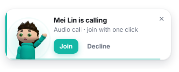

# Deskmate: your team's virtual desk

Deskmate is a live 3D desk where everyone on your team sits together. You can see at a glance who's at their desk, who's at lunch, who's focusing and who's away. When you're stuck, one click asks the team for help. A teammate taps the pop-up and you're both in an audio huddle within a few seconds.

It has three parts:

| Part | What it does |
|---|---|
| **Chrome extension** (`extension/`) | Desk in Chrome's side panel, help pop-ups on whatever page you're on, the call window, auto-away. Runs on macOS, Windows, Linux and ChromeOS. |
| **Mac menu-bar app** (`companion/`) | Icon and live count in the top menu bar, a one-click desk dropdown, help/call bubbles that float over **every** app (even full-screen), and global shortcuts. |
| **Server** (`server/`) | A small Node WebSocket service for presence, help requests and WebRTC call signalling. It never sees or stores audio. |


 




---

## Try it in 5 minutes (local)

```bash
# 1. server
cd server && npm install && npm start          # → ws://localhost:8787

# 2. Chrome extension
#    chrome://extensions → turn on Developer mode → "Load unpacked" → pick the extension/ folder
#    Pin Deskmate, click the icon → the side panel opens → enter name + team code → Join desk

# 3. Mac menu-bar app (optional)
cd companion && npm install && npm start
```

Open a second Chrome profile, or use a teammate's machine on the same network with `ws://<your-ip>:8787`, and join the same team code to see two people on the desk.

To fill the desk with simulated teammates for a demo:

```bash
node test/demo.cjs --live   # keeps 5 bots online in a team; set TEAM=<your code> to join theirs
```

---

## Features

**Presence that runs itself**

- **One-click status bar:** 💻 Here · 🍜 Lunch · ☕ BRB · 🎧 Focus. Click the active one again to go back to "Here".
- **Auto-away:** after *N* minutes idle, or the moment your screen locks, you show as 💤 Away. You come back automatically when you're active again.
- **Lunch timer:** "back in 32m" shows for everyone. Use **+15m** if lunch runs long. When you come back to your computer you're marked back at your desk without clicking anything (you can turn this off).
- **Google Chat sync** (optional): your Google Chat *Active / Away / Do not disturb* state and custom status flow into Deskmate. See [Google Chat setup](#google-chat-status-sync).
- **Manual beats automatic:** auto-away never overrides a lunch or Focus status you set yourself.

**The 3D desk**

- **Characters in an animated-film style:** big glossy eyes that blink and follow what they're doing, thick expressive brows, a button nose, a swoopy quiff, a hoodie with drawstrings, joggers with a side stripe and sneakers in your colour. Pick shirt colour, skin tone, hair colour, a hairstyle (short, long, bun, curly, spiky) and glasses (none, shades, round). Everything is built in code, so there are no model files to download.
- **Spring-driven motion:** poses settle with a little overshoot, characters hop when they react or need help, and squash when they sit down. At their desk they type on the laptop in bursts, pausing to read the screen. In the setup preview they wave, then fold their arms.
- Up to 4 people share one bench. Bigger teams get a second, staggered row behind so everyone stays large and visible.
- Everyone sits at the shared desk and types away. Going to lunch, your avatar **walks over to the café table and eats**. Going away, it walks off, your laptop closes and your chair turns. Focus mode puts headphones on, and calls add a headset and mic.
- Raised hand plus a bouncing **Needs help** tag when someone asks for help.
- Emoji reactions (👋 👍 🎉 ☕ 😂) float above your head on everyone's screen.
- Drag to look around, scroll to zoom, double-click to reset. Light and dark mode follow your system.
- Click anyone to see their status, local time and note, with **Wave** and **Call** buttons.

**Help → huddle in two clicks**

- Type what you need, or nothing, and press **Ask for help** (or `⌥⇧H` from anywhere).
- Teammates get an animated bubble on the right side of the screen showing your 3D avatar raising its hand, plus a system notification.
- The first person to tap **Join call** claims it. Everyone else's bubble changes to "Priya is on it ✓", so no one doubles up.
- Both call windows open automatically. Calls are peer-to-peer WebRTC audio with echo cancellation and noise suppression, a speaking ring, mute (`M`), add-a-teammate, and up to 6 people.
- Anyone can **Join** a huddle in progress from the desk.

**Fewer interruptions**

- **Focus mode** silences help pop-ups and waves. Direct calls still reach you, silently.
- If the Mac app is running, the Chrome extension stays quiet so you never get two pop-ups.
- Bubbles time out on their own. Hovering pauses the timer.

**Keyboard shortcuts** (Chrome: change them at `chrome://extensions/shortcuts`; Mac app: global)

| Shortcut | Action |
|---|---|
| `⌥⇧D` | Open the desk |
| `⌥⇧H` | Ask for help / cancel |
| `⌥⇧L` | Lunch on / off |
| `⌥⇧F` | Focus on / off |
| `1`–`4` in the panel | Here / Lunch / BRB / Focus |
| `/` in the panel | Jump to the help box |

---

## Deploying for your team

### 1. Host the server

The server is a ~370-line Node file with one dependency (`ws`). Any host that supports WebSockets will run it, for example Render, Railway, Fly.io, Cloud Run or a small VM. **Use TLS (`wss://`) in production.** Most hosts provide it automatically.

```bash
docker build -t deskmate-server server/
docker run -p 8787:8787 -e ALLOWED_DOMAIN=elevationservices.co.uk deskmate-server
```

| Env var | Purpose |
|---|---|
| `PORT` | Default `8787` |
| `ALLOWED_DOMAIN` | Only accept people whose email ends with this domain |
| `TEAM_CODES` | Comma-separated allow-list of team codes (empty = any) |
| `ICE_SERVERS` | JSON list of STUN/TURN servers handed to calls (see below) |

**TURN for corporate networks:** peer-to-peer audio works on most networks with the default Google STUN servers. Strict firewalls need a TURN relay, either self-hosted [coturn](https://github.com/coturn/coturn) or a managed service such as Twilio, Cloudflare Calls or Metered:

```bash
ICE_SERVERS='[{"urls":"stun:stun.l.google.com:19302"},{"urls":"turn:turn.example.com:3478","username":"u","credential":"p"}]'
```

### 2. Point the clients at it

Change `DEFAULT_SERVER` in `extension/lib/status.js` to your `wss://` URL so nobody has to type it. Otherwise each person pastes it under **Advanced** during setup.

### 3. Distribute the extension

- **Quick:** zip `extension/` and have people load it unpacked.
- **Proper:** publish it as an **unlisted** item on the Chrome Web Store, or force-install it to the whole org from the Google Admin console (*Devices → Chrome → Apps & extensions*). Auto-updates come for free.

### 4. Build the Mac app

```bash
cd companion && npm install && npm run dist     # → dist/Deskmate-x.y.z.dmg
```

To hand it out without macOS security warnings, sign and notarise it with an Apple Developer ID (`CSC_LINK`, `APPLE_ID`, etc. for electron-builder). The app runs as a menu-bar-only app (no Dock icon), asks for microphone access the first time you join a call, and can launch at login (right-click the menu-bar icon).

---

## Google Chat status sync

Deskmate reads **your own** Google Chat availability through the Chat API's `users/me/availability` endpoint and maps it like this: **Active → Here**, **Away → Away**, **Do not disturb → Focus**. Your Chat custom status becomes your Deskmate note. Each person's extension reads only their own status. Nobody can read anyone else's.

Requirements: a Google Workspace **Business or Enterprise** account. One-time setup for an admin:

1. In Google Cloud Console, create a project and enable **Google Chat API**.
2. Configure the OAuth consent screen as **Internal**.
3. Create an OAuth client ID of type **Chrome extension**, using your extension's ID (shown on `chrome://extensions`). To keep the ID stable for unpacked installs, add a `"key"` to the manifest.
4. Put the client ID in `extension/manifest.json` → `oauth2.client_id`.
5. Each person ticks **Sync my Google Chat status** in Deskmate settings and approves the one-time Google prompt.

The scope used is `chat.users.availability.readonly`. Deskmate never writes to your Chat status. Writing Focus back to Chat (DND) is a small follow-up if you want it (see the roadmap).

---

## How it fits together

```
 Chrome extension (MV3)                     Mac menu-bar app (Electron)
 ┌───────────────────────────────┐          ┌──────────────────────────────┐
 │ service worker                │          │ main process                 │
 │  • DeskClient (WebSocket)     │          │  • DeskClient (same code)    │
 │  • chrome.idle → auto-away    │          │  • powerMonitor → auto-away  │
 │  • Google Chat sync           │          │  • Tray icon + live count    │
 │  • badge, notifications       │          │  • always-on-top bubbles     │
 │ side panel → 3D desk (three)  │          │ panel → same desk UI         │
 │ content script → page bubbles │          │ bubble/call → same pages     │
 │ call window → WebRTC audio    │          │ call window → WebRTC audio   │
 └──────────────┬────────────────┘          └──────────────┬───────────────┘
                │      presence / help / call signalling (wss)
                └────────────────────┬──────────────────────┘
                              ┌──────▼──────┐
                              │  server/    │  in-memory rooms per team code
                              └─────────────┘
           audio flows peer-to-peer (DTLS-SRTP encrypted), never through the server
```

The Mac app reuses the extension's UI files. `npm run sync` copies them in, and `preload.cjs` provides the same `deskBridge` interface, so there's one desk to maintain.

---

## Privacy & security notes

- The server keeps **nothing on disk**. Presence lives in memory and disappears when people disconnect.
- Audio is end-to-end encrypted WebRTC. The server only relays connection set-up messages, and only between people in the same call.
- The content script runs on web pages only to show the help bubble inside an isolated iframe. It never reads page content. The extension doesn't request the `tabs` permission.
- **MVP trust model:** anyone who knows the team code and the server URL can join. Lock it down with `ALLOWED_DOMAIN` and `TEAM_CODES`, or add Google sign-in verification (roadmap item 1) before rolling it out widely.

---

## Testing

```bash
npm install && npx playwright install chromium   # once, at the repo root
cd server && npm install && cd ..
npm test                  # protocol rules: status priority, help claims, call isolation, grace period
npm run server &          # then, with the server running:
npm run test:e2e          # 3 real Chrome profiles: statuses, help bubble, WebRTC call, Focus mode
npm run demo              # screenshots of a 6-person desk (light + dark) → test/shots
```

The end-to-end test loads the real extension into three Chrome profiles. It checks that statuses sync, that the help bubble appears on an ordinary web page, that clicking **Join call** opens call windows for both people and connects WebRTC audio, that Focus mode suppresses pop-ups, and that hanging up notifies the other person.

---

## Roadmap ideas

1. **Google sign-in verification on the server**: verify a Google ID token on connect so identity can't be spoofed.
2. **Calendar-aware status**: auto 📅 *In a meeting* from Google Calendar, plus "free in 12 min" hints on the help button.
3. **Write Focus back to Google Chat** (`MarkAsDoNotDisturb`) so one switch silences both.
4. **Screen share** in huddles (one `getDisplayMedia` track) and push-to-talk.
5. **Pods/zones**: several tables per team (Design, Dev, Support) with a walk-over to visit another pod.
6. **Smart routing**: tag skills on people ("AWS", "Figma") and offer help requests to the right person first, then the whole team after 30 s.
7. **Scheduled statuses**: "Lunch at 1:00 every weekday", working hours and time-zone shading on the desk.
8. **Missed-help digest**: a gentle summary of requests you missed while in Focus.
9. **Windows tray build** of the companion (the code is cross-platform. It needs a Windows icon and installer config).
10. **Persistence** (Redis) so the server can run multiple instances behind a load balancer.

## Project layout

```
extension/   Chrome MV3 extension (load this folder unpacked)
  background.js        service worker: connection, idle, Google Chat, badge, notifications, call windows
  lib/                 shared: client.js (protocol), avatar.js (3D character), toon.js (springs/easing), status.js, three.js
  sidepanel/           the desk UI + setup/settings (also used by the Mac app)
  bubble/              animated help / call / wave pop-up
  call/                WebRTC audio huddle window
  content/content.js   injects bubbles into the page you're viewing
companion/   Electron menu-bar app (macOS first)
server/      Node WebSocket presence + signalling server (+ Dockerfile)
test/        protocol tests, end-to-end Playwright test, demo bots, gallery.html (every pose side by side)
docs/        screenshots
```
